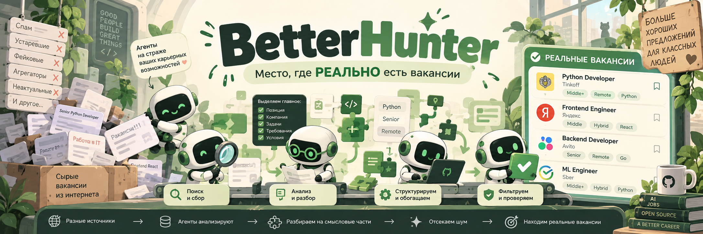

# BetterHunter

Хотел найти работу. Нашёл APK, декомпилятор и повод написать ещё одно Android-приложение.

**BetterHunter** — эксперимент с reverse engineering Android-приложения `ru.hh.android` и сборкой собственного MVP на Kotlin. Сначала посмотрели, как устроены отдельные клиентские механизмы, потом собрали локальный поиск вакансий. Где-то между этими этапами появилась тёмная тема. Приоритеты расставлены.

Баннер уже обещает карьеру. В приложении пока **18 вымышленных вакансий** и локальный mock gateway. На собеседование никто не позовёт, зато фильтры работают.

## Что получилось

- Поиск по тексту и фильтры по региону, опыту, формату работы и зарплате.
- Сортировка, пагинация и загрузка следующих страниц без дублирования карточек.
- Карточки вакансий, экран деталей и возврат к результатам поиска.
- Форматирование зарплат, включая диапазоны и отсутствующие значения.
- Тёмный Compose UI с зелёным акцентом, чипами и кнопками, которые поместились в экран хотя бы по замыслу.
- Демо-сценарии пустой выдачи и ошибки с повторной загрузкой. Страдать можно без интернета.

На этапе сборки MVP прошли **55 unit-тестов**. Новый UI скомпилирован; визуальную проверку последней версии на устройстве ещё не проводили. Честность тоже входит в стек.

## Technology Stack ⚡

### 📱 Android & UI

<p>
  
  
  
  
</p>

### 🧩 Architecture & State

<p>
  
  
  
  
  
</p>

JVM-модули держат модели, зарплатные форматтеры и поисковую логику. MVI связывает действия и состояние, Android-модули отвечают за экраны. Mock gateway позволяет проверить весь локальный путь без настоящего сервера и чужих аккаунтов.

### 🛠️ Build & Tests

<p>
  
  
  
  
  
</p>

## Чем разбирали APK 🔬

<p>
  
  
  
  
</p>

Через REA MCP и JADX Headless выборочно изучали пакеты, сигнатуры, методы и статические ссылки. Для выводов сохраняли evidence ID. Весь продукт в исходники не выгружали: интересовали небольшие механизмы, которые можно понять и проверить отдельно.

Из APK удалось разобрать отдельные преобразования строк и поисковых параметров. Модели BetterHunter, mock-ранжирование, правила локального поиска и оформление интерфейса — собственный дизайн эксперимента. Серверную выдачу HeadHunter по клиентскому APK мы, увы, не изобрели заново.

## Что лежит внутри

```text
reconstruction/
├── salary/       # Форматирование зарплат
├── vacancy/      # Модели вакансий, fixtures и UI mapping
├── search/       # Парсер, фильтры и локальный gateway
├── mvi/          # Store, actor, reducer и состояние
├── vacancy-ui/   # Compose-карточки и детали
└── android-app/  # Приложение и интеграция модулей
```

Бэкенд, авторизация и реальные аккаунты в этот эксперимент не вошли. Зато вакансии не протухают: мы их сами придумали.

## Как запустить

Спросите у агента. Он это собирал, ему и объяснять.

Для тех, кто предпочитает читать файлы: [заметки по сборке](reconstruction/android-app/INTEGRATION_NOTES.md).

---

[Apache 2.0](LICENSE) · Учебный эксперимент, с HeadHunter не связан.
