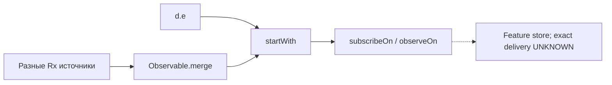

# Последовательности

## Роли и поток feature

Пунктиром помечены выводимые или неустановленные связи.

```mermaid
sequenceDiagram
    participant BS as SearchFiltersBootstrapper
    participant Store as Feature store (детали UNKNOWN)
    participant AC as SearchFiltersActor
    participant RD as SearchFiltersReducer
    participant VM as SearchFiltersViewModel
    participant UI as SearchFilters UI

    BS-->>Store: Observable<d>, startWith(d.e) [FACT]
    Store-->>AC: state + d [FACT по сигнатурам; доставка inference]
    AC-->>Store: Observable<a> [FACT]
    Store-->>RD: state + a [FACT по сигнатурам; dispatch inference]
    RD-->>Store: новый state c [FACT]
    Store-->>VM: state / b [часть подтверждена конструктором и Z5]
    VM-->>UI: UI model через converter [INFERENCE; вызов/связь не установлены]
    UI-->>VM: пользовательский callback [UNKNOWN]
```

## Подтверждённый участок `with_salary`

```mermaid
sequenceDiagram
    participant Source as UI / источник действия
    participant Event as domain.interactor.a.o0
    participant Red as SearchFiltersReducer
    participant SI as SearchFiltersStateInteractor
    participant State as SearchFiltersFeature.c
    participant Analytics as SearchFiltersAnalytics

    Source-->>Event: создание o0 [UNKNOWN: call site]
    Event->>Red: внутри a.C1116a [UNKNOWN: producer mapping]
    Red->>Analytics: APPLY/RESET LABEL "with_salary" по текущему khe.p [FACT]
    Red->>SI: b(currentState.a) [FACT]
    SI-->>Red: преобразованное состояние [FACT по вызову; семантика UNKNOWN]
    Red-->>State: новый SearchFiltersFeature.c [FACT]
```

## Bootstrap



Узлы merge представлены преобразованными потоками из `SearchFiltersBootstrapper.invoke`; их внутренние контракты здесь не раскрываются. Evidence: `ev_4a05c123592166f9b9bf24f7c1fad529d06eb8a7c77c1797276d3a7f05d71315`.
