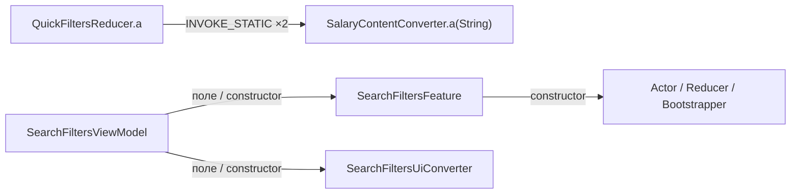

# Architecture map

Дата: 2026-10-19. Артефакт: `raw-source/base.apk`, `ru.hh.android` 26.38 (11487), minSdk 32, targetSdk 36.
SHA-256: `0ef900e1066cf63dd86e9924479bfe9bcc0a2669215984c4ccf97141c7953544`.
REA MCP 6.7.0 / JADX Headless 0.7.1. Только статические наблюдения.

**FACT** — наблюдается в метаданных, теле метода или статических ссылках. **INFERENCE** — интерпретация наблюдений. **UNKNOWN** — не установлено. Статическая связь не доказывает выполнение в production.

## Уровень карты

Полный inventory имён переиспользован без генерации исходников: `ev_b13cc7c1e41fd99efc66992791eb2b33c4f503cc55363271a46eb0429afc7c02`. FACT: 18 596 строк начинаются с ru.hh.; это namespace-срез, не доказательство авторства каждой строки. Имена пакетов не восстанавливают исходные Gradle modules.

| Пространство | FACT по именам | INFERENCE |
|---|---|---|
| ru.hh.android | _mediator.*DepsImpl, feature.root, RootRouter | Композиционный слой приложения и адаптеры зависимостей между feature |
| ru.hh.applicant.feature | search_vacancy, search, favorite, vacancy_info, employer_info, employer_reviews, resume, chat, career, part_time_job и другие | Вертикальное разделение функциональности соискателя; перечисление не означает исследование этих областей |
| ru.hh.applicant.core | vacancy_network, model.search, ui.vacancy_card, справочники | Общие клиентские модели, network mapping и UI adapters |
| ru.hh.shared.core | network, dictionaries, vacancy, ui, utils.coroutines | Общая инфраструктура и повторно используемые модели/конвертеры |

Содержимое auth, платных функций, защиты и пользовательские данные не исследовались. Названия этих областей могли присутствовать в общем inventory; их наличие не использовано для поведенческих выводов.

## Проверенный вертикальный срез: поисковые фильтры

FACT: SearchFiltersViewModel хранит SearchFiltersFeature, SearchFiltersUiConverter и SearchFiltersResultPublisher; конструктор связывает их типами. Evidence: `ev_b0e46bf0b46574f08464c7220c521677a29a9e7285a4c3db3bce06710f1484ae`.

FACT: SearchFiltersFeature конструируется с SearchFiltersActor, SearchFiltersReducer, SearchFiltersBootstrapper. Evidence: `ev_1169bc6064612535c1c477b106209f14e3393ec186fd944895876331e44bb6ba`.

INFERENCE: MVI/state-driven domain + ViewModel presentation, с отдельным преобразованием состояния для UI. Фактические event ordering, state immutability, эффекты и cancellation UNKNOWN; методы actor/reducer этого большого feature не декомпилировались.

FACT: AutosearchScreenKt имеет Compose-типизированные методы, но его связь с SearchFiltersViewModel в этом проходе не установлена. Не объединять разные экраны в доказанную execution chain.

## Доказанный небольшой путь

Связь reducer → salary formatter: `ev_07bc6be3663ded0b8e5494dc46c056536d95e20d6c6e1376da67119514e3fb01`, classes6.dex, DEX code-unit offsets 859 и 894; это два invoke внутри одного using node, не два runtime вызова. Связь между двумя показанными подсетями не устанавливалась.

## Data и клиентские модели

- FACT: NetworkApiBuilder имеет OkHttpClientFactory, UriSource и okhttp3.n. Evidence: `ev_baeb617b63cc3b32b20bd03a086cc8cf2f2c69fd003b713e0ed9d7ef51664e5e`.
- FACT: DictionaryDatabaseProvider строит Room dictionary.db из asset; содержимое не читалось. Evidence: `ev_d14e92c990274e7c7edbc8176d6ae01b463bb18c7ba5f569d438c97336c2e084`.
- FACT: VacancySearchStateConverter принимает VacancyTextQueryConverter, CurrencyRepository, CountryHostSource и обфусцированный c44; d принимает Uri и ru.hh.applicant.core.model.search.d. Evidence: `ev_83237b1c26dc0d619d80c3af333881c1c70f0d1dc5a1ef1d44fd3d62f4f1a5d5`.
- FACT: SalaryContentConverter.b использует модель n0i с двумя Long getter (getM/getN), ресурсный provider bfd и числовой helper g7b.c. Evidence: `ev_e166e3689d6f08f2925fe78cea8b23e379ae4f39dfe602d5a9a56870b3cc55f8`.
- INFERENCE: есть отдельные network DTO/mappers, domain/search state и presentation converters. Полное соответствие DTO ↔ domain и семантика всех полей UNKNOWN; имена пакетов model/mappers не заменяют трассировку.

## Навигация и DI

FACT: RootRouter хранит Flow-transform и Rx PublishSubject<Pair<Integer,Object>>; конструктор создаёт оба канала. Evidence: `ev_1bb9a9435a54621f91832beee1768adeb3c31731e1674c17e2772d8df871831f`, `ev_4d5909d842f1f09f42984d2c5aa4e7603cb3b99196da510bb06539b58653f788`.

INFERENCE: роутер совмещает coroutine- и Rx-интерфейсы событий навигации. UNKNOWN: back-stack semantics, доставляемость событий, lifecycle, deep-link routing. FeedbackWizardRootModoMagritteScreen имеет Parcelable API, default-argument constructor и Compose signatures (`ev_4024f7a3d499fa882034355ea364f4598f3dd164e853629a49fede443c5d23ef`); Modo вероятен, но наследование и вызовы библиотеки отдельно не проверены.

FACT: Toothpick factory принимает Scope и создаёт прикладной converter; это DI evidence, а не доказательство глобального DI graph. Evidence: `ev_c5b1919602e5f070bd21ce26e8a520ec8cde1d0243518a6de2896403905f4af4`.

## Ограничения

Карта выборочная; нет исходных module boundaries, runtime, backend, split/native анализа. Оптимизация могла удалить, объединить или встроить методы. Нельзя утверждать, что приложение целиком использует Clean Architecture, MVVM или одну MVI-библиотеку. Наиболее обоснована характеристика: feature-oriented packages, ViewModel + MVI-срез и отдельные data/presentation adapters.

